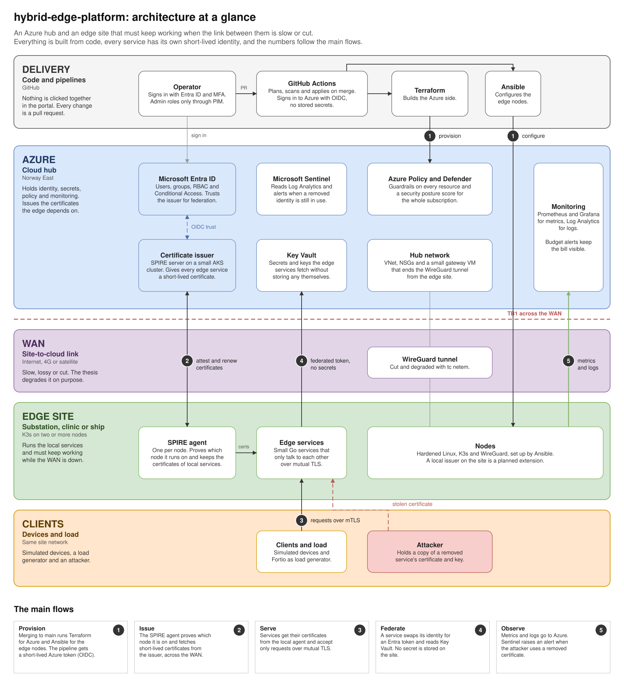

# hybrid-edge-platform

A hybrid platform with an Azure hub and an edge site, built entirely from code. The edge site runs services that authenticate each other with short-lived certificates, and it has to keep working when the link to Azure is slow, lossy or cut. My master's thesis ([edge-cert-auth-study](https://github.com/philipfleischer/edge-cert-auth-study)) measures exactly that part, and this repository is the platform around it.

Status: started November 2026. Nothing is built yet and the plan is below.

## What the platform is

An organization has a central cloud (Azure) and one or more remote sites: a substation, a clinic or a ship. The site runs a few services on a small Kubernetes cluster. Everything on the site must have an identity, everything in Azure must be built and changed through code, and the security team must be able to see what happens on both sides.

The platform has four parts:

- **Delivery.** All infrastructure lives in this repository. A pull request runs checks, and a merge to `main` runs Terraform for Azure and Ansible for the edge nodes. The pipeline signs in to Azure with OIDC, so no secrets are stored in GitHub.
- **Azure hub.** Entra ID for people and roles, a certificate issuer (SPIRE server) on a small AKS cluster, Key Vault, a hub network that ends the tunnel from the edge, Azure Policy and Defender for Cloud for guardrails and posture, and Log Analytics with Microsoft Sentinel for detection.
- **WAN.** A WireGuard tunnel between the hub and the site. In the thesis this link is cut and degraded on purpose with `tc netem`.
- **Edge site.** K3s on two or more Linux nodes. A SPIRE agent on each node fetches short-lived certificates for the local services, which only talk to each other over mutual TLS. Metrics and logs are sent to Azure when the link is up.

## Architecture

The diagram source is [`docs/diagrams/00-architecture-overview.drawio`](docs/diagrams/00-architecture-overview.drawio) and opens in diagrams.net. The numbers follow the main flows:

1. **Provision.** Merging to `main` runs Terraform for the Azure side and Ansible for the edge nodes.
2. **Issue.** The SPIRE agent proves which node it runs on and fetches short-lived certificates from the issuer in Azure, across the WAN.
3. **Serve.** The services get their certificates from the local agent and accept only requests over mutual TLS.
4. **Federate.** A service exchanges its identity for an Entra ID token and reads from Key Vault. No secret is stored on the site.
5. **Observe.** Metrics and logs go to Azure. Sentinel raises an alert when someone uses a certificate that has been removed, which is the attacker in the thesis threat model.

## Technologies and why

| Technology | Role | Why this one |
|---|---|---|
| Terraform | Builds everything in Azure | The most requested IaC tool in Norwegian cloud job ads, and it works across clouds. I also learn Bicep for AZ-104, but the platform uses Terraform. |
| GitHub Actions with OIDC | Plan, scan and apply on every change | Federated sign-in to Azure means no long-lived service principal secret. Checkov scans the Terraform code before it is applied. |
| Ansible | Sets up the edge nodes: hardening, WireGuard, K3s | Edge nodes are not cloud resources, so they need configuration management. Ansible is agentless and widely used for on-premises servers. |
| Microsoft Entra ID | Identity for people, roles and workload federation | The centre of security in Azure. RBAC, Conditional Access and PIM for people. Workload identity federation lets edge services use Azure without secrets. PIM needs an Entra ID P2 licence, so that part depends on a trial. |
| AKS | Runs the certificate issuer in Azure | Managed Kubernetes is what most Azure customers run. One small node pool that I stop when I am not using it keeps the cost low. |
| K3s | Kubernetes on the edge nodes | A small, single-binary Kubernetes made for edge hardware. Same API as AKS, so the same manifests and skills apply. |
| SPIFFE/SPIRE | Workload identity and short-lived certificates | Open source, a CNCF graduated project, and the issuer the thesis studies. It is built for the case where workloads cannot share a secret in advance. |
| WireGuard | Tunnel between the edge site and Azure | Azure VPN Gateway costs far more per month than a small VM, and I need full control of the link to cut and degrade it in the experiments. |
| Go | The edge services | I know Go from my earlier projects, and `go-spiffe` gives mTLS with SPIFFE identities with little code. |
| Prometheus and Grafana | Metrics and dashboards | Works on the edge site even when the link is down, and is the de facto standard in Kubernetes. |
| Log Analytics and Microsoft Sentinel | Central logs, detection and incidents | Sentinel is the SIEM many Norwegian organizations and SOCs use. Detection rules are written in KQL and kept in this repository. |
| Azure Policy and Defender for Cloud | Guardrails and security posture | Policy stops resources that break the rules before they are created. Defender shows what is still misconfigured. |
| Key Vault | Secrets and keys | The standard place for secrets in Azure, and the target of the federation flow. |

Some choices are deliberately simple. The issuer runs as a single SPIRE server first. A replicated issuer and a local issuer on the site (nested SPIRE) are extensions that the thesis may show are needed.

## Why I am building this

I want to work with cloud security. The usual way into that field is to start as a cloud or platform engineer and specialize from there, because securing a platform requires knowing how it is built, run and fixed. Job ads for these roles ask for the same things again and again: Azure, Entra ID, infrastructure as code, Kubernetes, Docker, Ansible, monitoring with Prometheus and Grafana, and the ability to automate and troubleshoot.

During my studies I have built many projects in different directions. The largest, [zero-trust-continuum](https://github.com/philipfleischer/zero-trust-continuum), was a zero trust architecture for a digital substation where I wrote most of the components myself in Go: the policy engine, the token service and the enforcement point. It taught me how those parts work inside, but not how to run the tools that organizations actually use. This project does the opposite. It uses standard, widely used tools, and the work goes into building, connecting, automating and securing them.

It is also one project instead of many. My thesis studies how certificate-based authentication behaves at the edge when connectivity degrades. Instead of keeping the thesis and my portfolio apart, the thesis testbed is one part of this platform, and the deepest one. The rest of the platform puts it in the context an employer would recognize: a real cloud, real identity management, monitoring and detection. That gives me one system I know well and can explain from several sides, from the Terraform code to the measurements in the thesis.

## What I will have learned

- **Building in Azure:** subscriptions, resource groups, networking with VNets and NSGs, AKS, Key Vault, Log Analytics, cost control with budgets and tags.
- **Identity:** Entra ID users, groups, RBAC, Conditional Access and PIM for people; managed identities and workload identity federation for software; SPIFFE identities and certificate lifetimes for services at the edge.
- **Automation:** Terraform modules and remote state, Ansible roles, CI/CD with OIDC, scanning infrastructure code before it is applied.
- **Kubernetes:** running AKS and K3s, deploying with manifests and Helm, debugging pods, networking and certificates.
- **Operations:** dashboards and alerts in Grafana, logs in Log Analytics, finding out why something stopped working.
- **Security:** guardrails with Azure Policy, posture with Defender for Cloud, detection rules in KQL, an incident runbook, and a threat and risk assessment of the platform.
- **Research:** designing experiments, measuring carefully and turning measurements into design advice (through the thesis).

## Courses and certifications (current timeplan)

The plan is to let the courses, the certifications and the platform support each other, so that the same work counts more than once.
This plan will change depending on summer internship opportunities.

| Period | Course or certification | How it feeds the platform |
|---|---|---|
| Autumn 2026 | IN5700 Fog and cloud computing, IN5020 Distributed systems, TEK5520 Cybersecurity in industrial systems | Edge-fog-cloud architecture, failure models and consistency, and the energy and OT background for the substation scenario. |
| Winter 2026/27 | AZ-104 Azure Administrator | The Azure foundation: identity, networking, compute, storage and monitoring. Milestone M0 is built at the same time. |
| Spring 2027 | IN4180 Cyber operations, with SC-200 Security Operations Analyst | Monitoring, detection and incident response. Gives the Sentinel rules and the incident runbook. |
| Spring 2027 | IN5080 Security and risk management | Threat and risk assessment of the platform, and a DPIA for the clinic scenario where patient data is involved. |
| Spring 2027 | IN5031 Protocols and AI for the future Internet | Network quality of service, IoT and smart grids. Supports the work on degraded links. |
| Summer 2027 | Terraform Associate, CKA | Terraform and Kubernetes are used every day in the platform and in the thesis. |
| Autumn 2027 to spring 2028 | Thesis; CKS and SC-500 Cloud and AI Security Engineer if time allows | Hardening Kubernetes and securing Azure workloads, applied to the platform. |
| Planned for Later | SC-100 Cybersecurity Architect | Architecture-level security design, after some work experience. |

## Use of AI

AI tools are used to look things up, to get feedback on design decisions and to review text. I write the code and configuration myself.
